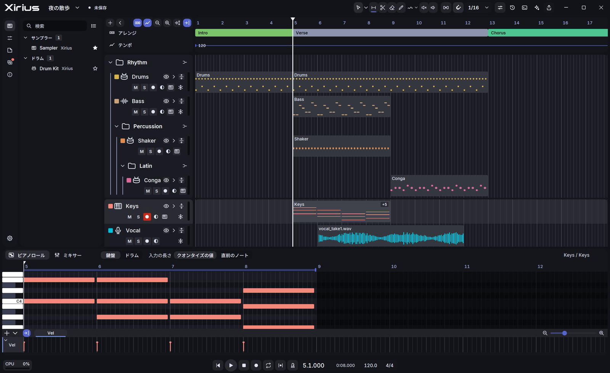

# Xirius

An open-source digital audio workstation (DAW) written in Rust, with a GPUI-based UI. It is
made to be easy to move to from **Fender Studio Pro**: the keys, the words of the screens and
the way a song is laid out follow it where that helps. Xirius is not affiliated with, endorsed
by, or supported by Fender or PreSonus. See `TRADEMARKS.md`.



- **License:** `MIT OR Apache-2.0` (see `LICENSE-MIT` and `LICENSE-APACHE`)
- **Runs on:** Windows 10 and 11, x64. That is the only build that is made and given out; macOS
  is a goal for later and is not distributed yet.
- **Plugins:** VST3 and CLAP instruments and effects. VST2 is not supported.
- **Name and logo:** see `TRADEMARKS.md`. "VST" and "ASIO" are Steinberg marks and are not part
  of the name.
- **Status:** 1.0.

## What it does

- Records audio and MIDI, and edits them in the arrange window and the piano roll, with
  comping, automation and the usual editing tools.
- Mixes with a console of tracks and folder tracks, inserts, sends and the built-in effects.
- Hosts VST3 and CLAP instruments and effects, each in its own process when you ask for it.
- Imports and exports DAWproject, and exports WAV, FLAC and MP3.
- Has a command line (`xirius`) and an MCP server (`xirius-mcp`) for scripts and assistants.

`docs/plan.toml` is the list of what is decided and what is still open; not everything in it is
in this release.

## Where things are

- `docs/plan.toml` is the canonical list of decided policy (items, dropped decisions, open
  questions).
- `docs/PLAN.md` explains how progress is tracked (in Japanese).
- `docs/ui-approved.md` describes the approved UI; `docs/licenses.md` records the dependency
  policy.

## Tests

`cargo test --workspace` runs everything that holds on a busy machine (a parallel build): the
tests wait on what happened, not on a time. The tests whose point is keeping up with real time
are `#[ignore]`d; run them on a quiet machine:

```sh
cargo test -p xirius-engine --test sandbox -- --ignored
cargo test -p xirius-session --test isolation -- --ignored
```

## Building from source

Windows 10 or 11, x64.

- [Rust](https://rustup.rs/): the toolchain is pinned in `rust-toolchain.toml`, so `rustup` gets
  the right version by itself.
- Visual Studio 2022 with the "Desktop development with C++" tools, and the Windows SDK. The
  GPUI build compiles its shaders with `fxc.exe` from the SDK; if it is not on `PATH`, set
  `GPUI_FXC_PATH` to it.

```sh
git clone https://github.com/tekalu1/xirius
cd xirius
cargo run -p xirius-ui            # debug build
cargo run -p xirius-ui --release  # the build the release is made from
```

MP3 export needs the LAME library, which is not built into Xirius. WAV and FLAC export work
without it. To build it (Visual Studio's C++ tools are enough):

```powershell
powershell -ExecutionPolicy Bypass -File scripts/build-lame.ps1
```

The VST3 test plugins use the VST3 SDK in `third_party/vst3sdk` (a submodule); get it with
`git submodule update --init` if you want to run those tests. The app itself does not need it.

## Installing on Windows

Each release on the [releases page](https://github.com/tekalu1/xirius/releases) has:

- `Xirius-<version>-win-x64-setup.exe`: the installer. It installs for your user only, into
  `%LOCALAPPDATA%\Programs\Xirius`, and needs no administrator rights. Uninstall it from
  Settings → Apps; your songs and settings are kept.
- `Xirius-<version>-win-x64.zip`: the same files without an installer. Unpack it anywhere and
  run `xirius-ui.exe`.
- `SHA256SUMS.txt`: the SHA-256 checksum of every file of the release.

### The SmartScreen warning

The Windows builds are not code-signed yet, so the first time you run the installer (or
`xirius-ui.exe` from the zip) Windows may show **"Windows protected your PC"**. Check the
checksum first (below). If it matches, click **More info**, check that the file name is the
one you downloaded, and click **Run anyway**. Windows does not ask again for that file.

If the download was blocked in the browser, choose **Keep** (in Edge: **…** → **Keep** →
**Show more** → **Keep anyway**).

### Smart App Control

Windows 11 may have **Smart App Control** turned on. It does not let an unsigned program run at
all, so there is no **Run anyway** to choose: turn it off in Windows Security → App & browser
control → Smart App Control before installing. Turning it off cannot be undone without
resetting Windows. A signed build, when there is one, will not need this.

### Checking the checksum

Download `SHA256SUMS.txt` from the same release and compare. In PowerShell, in the folder
with the downloads:

```powershell
Get-FileHash .\Xirius-1.0.0-win-x64-setup.exe -Algorithm SHA256
Select-String -Path .\SHA256SUMS.txt -Pattern 'Xirius-1.0.0-win-x64-setup.exe'
```

or in Command Prompt:

```bat
certutil -hashfile Xirius-1.0.0-win-x64-setup.exe SHA256
findstr setup.exe SHA256SUMS.txt
```

The two hashes must be the same (letter case does not matter). If they differ, do not run
the file: download it again from the releases page.

## Updating

Xirius checks for a newer release while it runs, and 「Xirius について」 (About) says when there
is one. Choosing 「更新して再起動」 there downloads the new version, checks its signature, asks
about unsaved changes as closing always does, and restarts Xirius into it. Nothing is downloaded or installed without that choice. The
plugins, the songs and the settings stay as they are. The check and the beta channel are in the
settings (一般 → 更新).

## The MP3 encoder

MP3 export uses LAME (`lame_enc.dll`, LGPL-2.0-or-later), which is shipped next to the
program as a separate library. Its license and where to get its source are in
`licenses\LAME-COPYING.txt` and `licenses\LAME-SOURCE.txt`; the source tarball is also
attached to every release and can be opened from 「Xirius について」.
